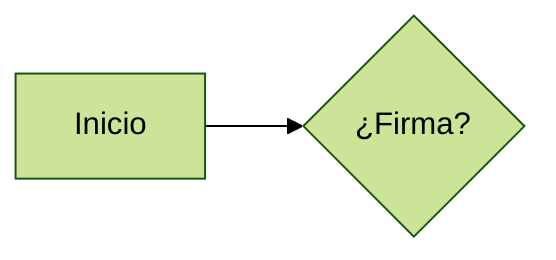

Título setext
=============

Subtítulo setext
----------------

Párrafo con salto forzado  
y otro con barra\
y *cursiva*, __negrita__, ~~tachado~~, `código`, <kbd>Ctrl</kbd> y un [enlace][ref].

[ref]: https://iurefficient.com "Iurefficient"

* viñeta con asterisco
* otra
    * anidada a cuatro espacios
+ lista con más

1) numerada con paréntesis
2) segunda

7. empieza en siete
8. ocho

- [ ] tarea
- [x] hecha
  - [ ] subtarea

> Cita
>> anidada
> - con lista

> [!NOTE] Aviso
> Cuerpo del aviso.

> [!MINDMAP|map layout-radial shape-cloud palette-warm root-l] Estrategia
> - Análisis
>   - Contrato
> - Audiencia

~~~python
def f():
	return 1
~~~

    código indentado

| Izq | Centro | Der |
|:----|:------:|----:|
| a   |   b    |   c |
| \| | `x|y`  |     |

Nota al pie[^1] y otra[^larga].

[^1]: Texto de la nota.
[^larga]: Una nota
    con dos líneas.

  <b>HTML</b> suelto

<!-- iure:segment {"speaker":"Ana","start":"00:01:02"} -->
Segmento con metadatos.

***

Fórmula $x^2$ y en bloque:

$$
\int_0^1 x\,dx
$$

Línea final sin salto